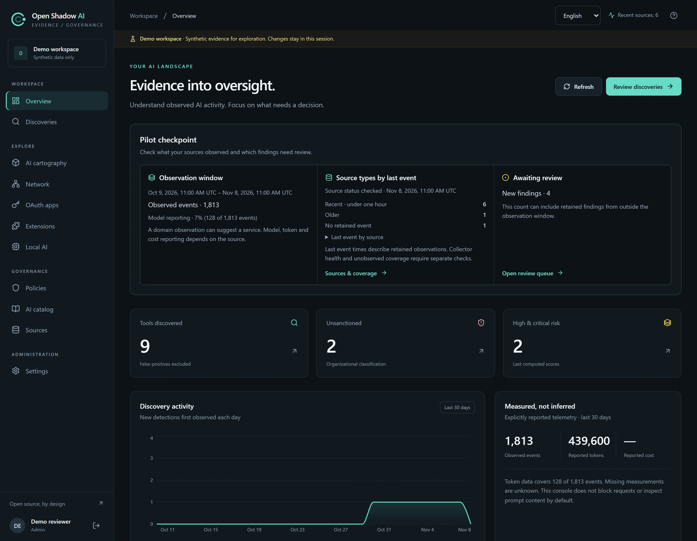
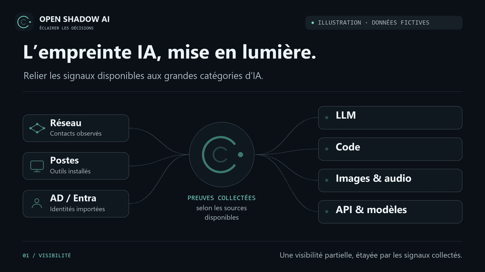
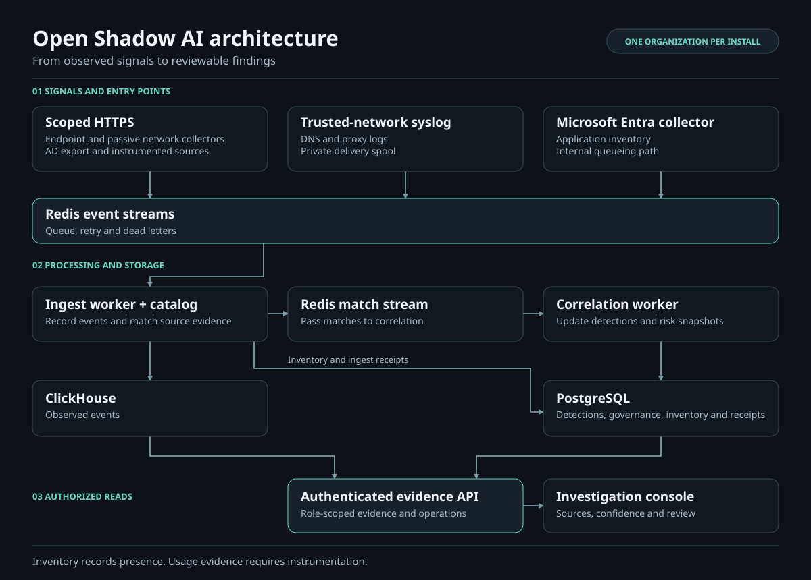

<p align="center"></p>

# Open Shadow AI

[English](README.md) | [Français](README.fr.md) | [简体中文](README.zh-CN.md)

[](https://github.com/alebgl77/open-shadow-ai/actions/workflows/ci.yml)
[](LICENSE)

**Découvrez l'IA sur votre infrastructure, avec les preuves derrière chaque constat.**

Comprenez quels services et outils d'IA apparaissent dans votre environnement, d'où vient chaque signal et ce qu'il permet réellement d'établir. Rassemblez métadonnées réseau, inventaires des postes et signaux des annuaires Microsoft dans une interface d'investigation.

[Essayer l'interface](#essayer-linterface) · [Guide d'évaluation DSI (en anglais)](docs/enterprise-evaluation.md) · [Déployer](#démarrage) · [Documentation](docs/README.md)

> Logiciel en phase initiale, destiné à l'évaluation et aux pilotes maîtrisés. Chaque déploiement dessert une seule organisation. Validez votre infrastructure avant tout usage en production.

## Essayer l'interface

Suivez un parcours de revue de 15 minutes sur des données synthétiques. Il vous faut Git et **Node.js 22.22.2+ (22.x)**. La démonstration s'exécute en local, sans Docker, sans identifiants et sans accès à vos annuaires ni à vos postes.

```bash
git clone https://github.com/alebgl77/open-shadow-ai.git
cd open-shadow-ai/frontend
npm ci
npm run demo
```

1. Ouvrez `/demo` à l'adresse affichée par le serveur de développement. Dans le **Tableau de bord**, vérifiez la période d'observation et les sources qui ont fourni des preuves. Consultez **Sources et couverture** pour voir ce que chaque source permet d'établir.
2. Dans **Découvertes**, comparez **Perplexity** (une résolution DNS) et **Ollama** (un signal remonté par un poste). Examinez la provenance et distinguez la présence d'un outil de son usage effectif.
3. Passez une découverte synthétique en revue, puis ouvrez **Gouvernance** pour voir un exemple d'outil approuvé et son responsable. Le [guide d'évaluation DSI (en anglais)](docs/enterprise-evaluation.md) donne les critères pour décider de lancer un pilote.



## La découverte en mouvement

Trois schémas muets en français expliquent l'empreinte IA, les niveaux de preuve et la reprise des collecteurs. Ces illustrations éditoriales utilisent des données synthétiques ; elles sont distinctes de l'interface réelle présentée ci-dessus.



[Voir les trois schémas (référence en anglais)](docs/motion.md) · [Ouvrir/télécharger le MP4](docs/assets/motion/footprint.mp4) · [Voir l'affiche statique](docs/assets/motion/footprint.webp)

## Pourquoi ce projet

- **Des preuves vérifiables.** Distinguez observations réseau, logiciels installés, inventaire des annuaires et usage instrumenté.
- **Une infrastructure sous votre contrôle.** Hébergez l'API, les files, le stockage des événements et l'interface.
- **Une adoption progressive.** Commencez par une source de journaux ou quelques postes gérés.
- **Un catalogue ouvert.** Examinez et améliorez les signatures utilisées pour les classifications.
- **Des limites explicites.** Un signal absent reste inconnu ; une requête DNS n'est ni un prompt ni une facture.

## La direction envisagée

Voir l'empreinte. Comprendre le risque. Garder le contrôle. La [roadmap en six étapes](docs/fr/roadmap.md) prévoit une découverte enrichie, la visibilité des agents, une analyse locale facultative, des investigations sourcées, des usages encadrés et une qualification continue. Chaque étape future comporte des critères mesurables ; les technologies candidates restent des propositions à évaluer.

## Démarrage

Si vous avez lancé la démonstration, arrêtez-la et revenez à la racine du dépôt. Ignorez les lignes `git clone` et `cd open-shadow-ai` ci-dessous si vous avez déjà cloné le dépôt.

Prérequis : Git, Python 3.12+ et un Docker Engine fonctionnel avec Compose v2. Aucun runtime Docker n'est fourni. L'interface initiale écoute en HTTP sur localhost ; les agents distants nécessitent un reverse proxy HTTPS.

```bash
set -e
git clone https://github.com/alebgl77/open-shadow-ai.git
cd open-shadow-ai
bash scripts/bootstrap.sh
docker compose config --quiet
docker compose up -d --build api ingest-worker correlation-worker purge-worker frontend
for attempt in $(seq 1 30); do
  if MSYS2_ARG_CONV_EXCL='*' docker compose exec -T api python /app/entrypoint.py python -m shadai.workers.redis_lifecycle reconcile --execute --legacy-writers-stopped; then break; fi
  if [ "$attempt" = 30 ]; then exit 1; fi
  sleep 2
done
docker compose up -d --wait --wait-timeout 180 api ingest-worker correlation-worker purge-worker frontend
docker compose run --rm api python -m shadai.cli create-admin
```

Sous Windows, préparez un checkout de confiance et exécutez d’abord `./scripts/bootstrap.ps1` dans PowerShell. Dans Git Bash, utilisez ce même checkout et contexte Docker : exécutez `set -e`, puis les commandes Compose du bloc ci-dessus ; ignorez `bash scripts/bootstrap.sh`. La boucle nécessite Bash et ne s’exécute pas directement dans PowerShell. Le préfixe par appel `MSYS2_ARG_CONV_EXCL='*'` empêche la [conversion de chemins de Git Bash](https://www.msys2.org/docs/filesystem-paths/) de modifier les chemins des conteneurs ; il ne modifie aucun réglage global d’environnement. Les deux bootstraps préservent les secrets et la configuration existants ; prévisualisez avec `-DryRun` ou `--dry-run`.

Attendez que les nouveaux workers initialisent leurs groupes Redis réels avant la réconciliation ; réessayez si cette initialisation est encore en cours. Lors d'une mise à niveau, arrêtez tous les anciens producteurs, workers et clients de rejeu avant de lancer la version indexée. La readiness exige le schéma de rétention réconcilié. Consultez la [rétention des files (référence en anglais)](docs/queue-retention.md) et la [qualification (référence en anglais)](docs/production-qualification.md) pour les comportements de panne et la répétition isolée.

Ouvrez [localhost:3000](http://localhost:3000). Les migrations PostgreSQL s'exécutent dans le service `migrate` avant le démarrage de l'API ; les trois schémas ClickHouse sont chargés sur un volume neuf. La [mise à jour d'une installation existante (référence en anglais)](docs/deployment.md#updates) exige des migrations ClickHouse distinctes.

L'activation des collecteurs est explicite :

```bash
docker compose --profile syslog up -d
# After configuring Entra IDs and its separately provisioned client-secret file:
docker compose --profile entra up -d
```

Les exports AD et installations sur les postes sont réalisés par l'opérateur, selon le [guide Microsoft (référence en anglais)](docs/microsoft.md). Installer le serveur ne déclenche pas de scan automatique du parc.

Les administrateurs peuvent inscrire des collecteurs à périmètre restreint dans **Sources et couverture**, distribuer leurs clés à affichage unique par un canal privé, puis les renouveler ou les révoquer. Les collecteurs de postes, réseau et syslog disposent de files de livraison persistantes et bornées ; l'état du pipeline distingue travail en attente, entrées conservées et pertes de capture inconnues. Le [guide d'exploitation (référence en anglais)](docs/collector-operations.md) détaille inscription, reprise après redémarrage, supervision authentifiée et rétention des identités.

La [connexion OIDC et le provisionnement SCIM facultatifs (référence en anglais)](docs/sso-scim.md) gèrent l'accès à la console, notamment avec Microsoft Entra ID. Ils sont désactivés dans le déploiement de base et utilisent des identifiants distincts du collecteur d'inventaire. La connexion d'un administrateur local reste disponible pour la récupération.

## Ce qui est livré

Le tableau décrit le code du dépôt. Consultez la [documentation et la disponibilité des préversions](docs/README.md) pour connaître les différences de version. Consignez le commit exact, la configuration et les empreintes d'images que vous évaluez. Retrouvez le parcours de qualification dans le [guide de mise en œuvre](docs/fr/README.md), le [compte rendu d'audit du 15 octobre](docs/fr/audit-remediation-2026-10-15.md) et la [gouvernance du dépôt](docs/fr/repository-governance.md).

La console propose l'anglais, le français et le chinois simplifié avant et après connexion. La préférence de langue reste dans le navigateur et l'anglais est utilisé si elle est indisponible. Les valeurs brutes des sources et les identifiants d'API conservent leur forme d'origine.

| Fonctionnalité | État et limite pratique |
|---|---|
| Interface React d'investigation, catalogue et processus de gouvernance | Implémentés ; à évaluer avec vos données |
| Parseurs DNS/proxy et collecteur syslog | Implémentés ; le parseur et le listener doivent correspondre à la source |
| [Analyse réseau passive (référence en anglais)](docs/network-analysis.md) | Imports de métadonnées Zeek/Suricata/TShark, PCAP hors ligne facultatif ou capteur live explicitement choisi, vue des preuves `/network` ; les noms observés ne prouvent pas des requêtes IA |
| [Cartographie IA](docs/fr/cartography.md) | `/cartography` relie observations réseau et installations déclarées par les postes aux services du catalogue, avec navigation 3D/liste, preuves des événements conservés et radars protocole/famille du catalogue sur les observations chargées ; couverture bornée, présence et observations ne prouvent pas un usage |
| Agent pour les postes | Inventaire des processus, conteneurs, runtimes et extensions implémenté ; vérification par OS et déploiement de parc à réaliser |
| Inventaire des extensions de navigateur | État par installation (version, activation, source d'installation, utilisateur, profil) pour les utilisateurs/profils locaux accessibles des postes équipés de l’agent 0.3.0, historique des changements de version et export audité dans **Extensions** implémentés ; preuve de présence conservée pendant la fenêtre d'identité, pas d'usage |
| Collecteur Microsoft Entra | Inventaire des service principals et grants facultatifs implémenté ; classification IA fondée sur des mappings d'application-ID revus ; validation sur tenant réel à réaliser |
| Active Directory local | Exporteur PowerShell en lecture seule, limité aux OU ; validation RSAT/AD réel à réaliser |
| Ingestion générique d'événements | Lots authentifiés et bornés ; les adaptateurs personnalisés restent votre travail d'intégration |
| Inscription et reprise des collecteurs | Identifiants à affichage unique et portée limitée, rotation/révocation, files locales bornées et rejeu explicite des dead letters ; vérifier les résultats CI natifs et magasins du commit déployé |
| Preuves de modèle/tokens/coûts | Métadonnées instrumentées acceptées lorsqu'elles sont fournies ; les journaux réseau ne produisent pas ces valeurs |
| Autres annuaires (LDAP, Okta, Google Workspace) | Contrat d'ingestion personnalisé disponible ; connecteurs natifs prévus |
| Docker Compose | Package de déploiement et test de services CI fournis ; valider le premier démarrage |
| Kubernetes | Base pour magasins externes ; validation du cluster, ingress, sauvegardes et montée en charge à réaliser |
| SSO OIDC et provisionnement SCIM 2.0 de la console | Sous-ensemble facultatif implémenté avec guide Entra ; validation d'interopérabilité sur tenant réel à réaliser |
| Isolation multi-organisations et gestion automatisée du parc | Prévues ; une organisation par installation actuellement |
| Blocage en ligne, DLP des prompts et analyse comportementale complète | Hors du produit actuel |

## Architecture



[Schéma draw.io éditable](docs/assets/architecture.drawio) · [Mermaid et flux de données (référence en anglais)](docs/architecture.md)

Le package Python et le préfixe des variables d'environnement restent `shadai` pour compatibilité. Le nom public du projet est **Open Shadow AI**.

## Preuves, confidentialité et limites

La configuration par défaut ne stocke jamais les chemins d'URL, chaînes de requête ou user agents. À l'ingestion, les chemins sans chaîne de requête et les user agents sont comparés en mémoire aux motifs du catalogue limités aux hôtes de chaque produit ; seule l'entrée reconnue du catalogue est conservée. `privacy.match_transient_signals: false` désactive cette comparaison. Traitez noms d'utilisateur, identifiants d'appareil et exports d'annuaire comme des données personnelles ou organisationnelles. Définissez rétention et accès selon votre déploiement.

L'appartenance d'une identité expire indépendamment selon chaque observation (par défaut au plus 30 jours) ; les comptes affichés portent sur des identifiants distincts observés, pas sur l'effectif salarié. La pseudonymisation facultative du serveur affecte les nouveaux traitements et ne nettoie ni l'historique ni les files locales en clair. Les scores de risque conservent leur dernier calcul et exposent une date nullable ainsi qu'un indicateur d'obsolescence. Le nettoyage historique est une maintenance explicite et bornée ; voir [rétention et pseudonymisation des identités (référence en anglais)](docs/collector-operations.md#retain-and-pseudonymize-identities).

Une résolution DNS indique un contact avec un domaine, pas une interaction IA achevée. Une extension installée ou une application d'annuaire indique présence ou autorisation, pas usage. L'inventaire des extensions de navigateur sert à l'examen d'incidents, pas à la surveillance des salariés : ses lignes et son export sont réservés aux analystes et administrateurs, le réglage actuel de confidentialité s’applique aux nouveaux traitements des libellés de poste et d’utilisateur, tandis que les libellés existants peuvent conserver leur forme précédente jusqu’au prochain instantané et les lignes expirent avec la fenêtre d'identité. Les identifiants de modèle sont des preuves déclarées ; les totaux de tokens et coûts nécessitent une instrumentation. Les coûts calculés restent des estimations jusqu'à leur rapprochement avec la facturation du fournisseur.

Postes non gérés, DNS chiffré non observé, outils locaux, domaines partagés, IA intégrée aux SaaS et contournements de passerelle peuvent laisser des angles morts. Consultez le [guide de couverture (référence en anglais)](docs/collectors.md) et l'[analyse de marché (référence en anglais)](docs/market-analysis.md).

## Contribuer

Consultez [CONTRIBUTING.md (référence en anglais)](CONTRIBUTING.md), proposez une modification limitée et reproductible et fournissez des fixtures synthétiques pour les collecteurs. Signalez les vulnérabilités en privé selon [SECURITY.md (référence en anglais)](SECURITY.md).

Licence [Apache-2.0](LICENSE). Copyright des contributeurs Open Shadow AI.

Pour le dimensionnement et le déploiement progressif, voir la [planification de capacité (référence en anglais)](docs/capacity.md). Toute affirmation de débit exige des mesures sur votre charge.

## Auteur

Conçu et maintenu par **[Alexandre Beguel](https://github.com/alebgl77)**, architecte IA agentique et CAIO externalisé basé à Paris. Il travaille sur l'IA générative en production, le LLMOps, le FinOps des LLM et la gouvernance de l'IA fondée sur les preuves. [beguel.com](https://beguel.com/) · [LinkedIn](https://www.linkedin.com/in/beguel/) · [Profil en français, anglais et espagnol](https://alebgl77.github.io/fr/)
