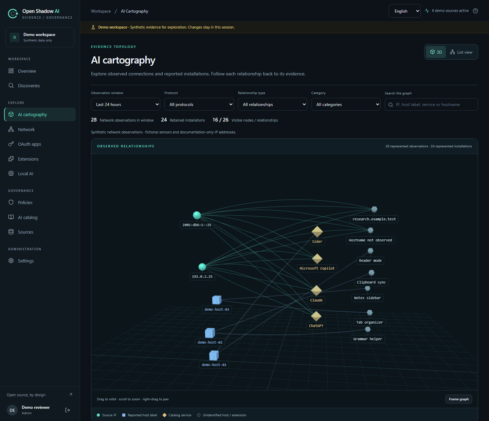
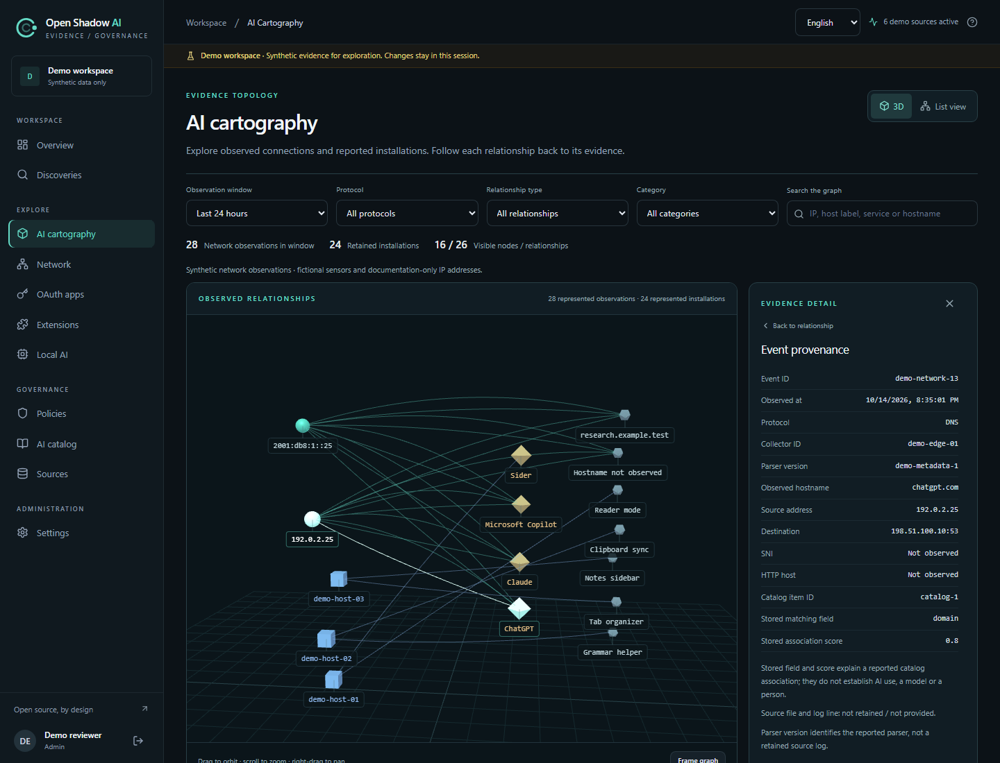
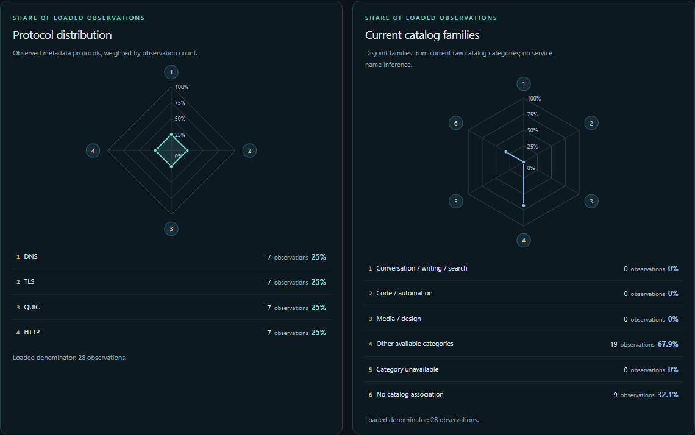

# AI cartography

[English](cartography.md) | [Français](fr/cartography.md) | [简体中文](zh-CN/cartography.md)

Open Shadow AI's `/cartography` view connects network observations and reported host installations to AI catalog services. It supports investigation of retained evidence; it does not scan hosts or establish actual AI use. This feature requires a source revision that includes the cartography route: record the exact deployed commit rather than relying on the preview version number.



Actual application screenshot, English interface, fictitious demo data. The separate source IP and reported host groups are not joined.

## 1. Read the relationships

| Relationship | Evidence behind it | What it cannot establish |
|---|---|---|
| Source IP → observed service or domain | Network observations grouped by `source_ip`, `domain`, `catalog_match_id` and `protocol` in the selected window | Device, employee, completed request, prompt, model, tokens or data transfer |
| Reported host → installed AI tool | Retained browser extension inventory with a reported `host_label` and collector scope | Connection from that host's IP or actual extension/tool use |
| Observation → catalog service | Stored `catalog_match_id`, `match_field` and `match_confidence`, with current catalog labels where available | Proof of inference or a usage/risk score |

An IP and a reported host are separate nodes. No AD, DHCP, NAT, device or person join is inferred. Host labels are grouped within each collector; a label is reported evidence, not a verified physical-device identity. Unknown addresses, names and catalog associations remain unknown. Unmatched domains and extensions are displayed separately from catalog services. A service label identifies a catalog association; it does not identify an exact model. `match_confidence` ranges from 0 to 1 and describes catalog matching only.

Network observations cover their selected time window. Installation evidence follows the existing inventory/identity retention window; it is not filtered into network activity by the graph's time selection. Multiple observations are not AI request counts, and an empty graph does not prove that AI is absent.

## 2. Open and investigate

1. Sign in as an **analyst** or **administrator**, then open `/cartography`.
2. Select the **24-hour or 168-hour** network observation window and, if needed, a protocol. Review totals and any truncation notices before interpreting the drawing. Relationship type, category and text search filter already loaded relationships; they do not fetch all omitted server evidence.
3. Select a relationship or its accessible list entry to inspect the retained evidence. Keep the displayed source IP separate from any reported host label.
4. For network evidence, inspect the event UUID, timestamp, protocol, source/destination addresses, destination port, observed domain, collector ID, parser version and stored catalog match fields. Missing fields remain unavailable.
5. For installation evidence, review the inventory record and use a discovery link only when a real detection ID exists. An installation without a detection is still presence evidence; no discovery is invented.

The source log's filename and line number are **not retained** and are unavailable in event details. Cartography does not provide arbitrary file access or a raw-log download. The separate network collector metadata export is described in [Passive network analysis (English reference)](network-analysis.md).



Actual event-detail panel, English interface, fictitious demo data. The displayed demo identifier is synthetic, not a production UUID. The stored score explains a catalog association and does not prove AI use.

## 3. Navigate the view

The 3D view uses a perspective camera: drag to orbit, scroll to zoom and right-drag to pan. **Frame graph** resets and refits the camera. Click a node to see its connected relationships, or a link to inspect that relationship. **List view** is a 2D relationship table; it is also the automatic fallback when WebGL2 or the 3D scene is unavailable.

Use the table's source, service and **Inspect relationship** buttons with the keyboard. The **Select a node with the keyboard** disclosure also provides node buttons in 3D mode. From the detail panel, open an event's UUID to inspect its retained provenance. **Escape** returns from event details to the relationship, or closes the detail panel. Selecting a source IP or catalog service lists its events across all protocols in the selected window; selecting a network relationship uses its exact source, domain, catalog association and protocol.

Rendering is bounded and runs on demand, without idle animation or camera damping, including for reduced-motion users. Layout distance, node size and visual position do not measure actual network topology, transfer volume or risk. The graph is a view of evidence, not a reconstruction of packet paths.

### Read the two network radars

The two independent radar cards summarize the loaded network relationships for the current time window and protocol query, **before** local relationship type, category and search filters and the 160-node/320-edge drawing caps. Installation evidence is excluded; it remains presence evidence within its independent retention window.



Actual application screenshot, English interface, synthetic demo data. The shares describe loaded observations only.

Each axis is weighted by observations, not by the number of relationships. Let `R` contain the unique exact (`source_ip`, `domain`, `catalog_match_id`, `protocol`) tuples after the existing deduplication. Then `D = Σ(r ∈ R) observations(r)`, `n(axis) = Σ(r ∈ axis) observations(r)` and `share(axis) = 100 × n(axis) / D`. Both radars use the same **0–100%** scale. With `D = 0`, the summary is unavailable and no polygon is drawn; with `D > 0`, an absent axis is **0%**. Polygon area is neither an aggregate score nor a measure of activity, risk or matching confidence.

The protocol radar has exactly four axes: `DNS`, `TLS`, `QUIC` and `HTTP`. The catalog family radar has six axes, using the **current** loaded catalog categories:

| Catalog family axis | Included relationships |
|---|---|
| Conversation, writing and search | `llm_chat`, `writing_assistant`, `translation_ai`, `search_ai` |
| Code and automation | `code_assistant`, `agent_automation` |
| Media and design | `image_gen`, `voice_ai`, `video_ai`, `design_ai` |
| Other available category | Every other nonempty category, including platforms, data, custom categories and the demo's `saas_app` |
| Category unavailable | Non-null `catalog_match_id` whose entry is not loaded or whose category is empty |
| No catalog association | Null or absent `catalog_match_id` |

A missing catalog lookup is not an absent association. Categories remain free-form; the grouping does not rename them or infer a family from a brand or service name. Current categories do not reconstruct historical classification. Catalog association proves neither use, activity, model or identity, nor risk or confidence. If catalog loading fails, the family radar is unavailable rather than filled with synthetic zeroes; the protocol radar remains usable when network relationships are valid. A network error does not substitute another dataset.

Compare the displayed computed loaded denominator `D` with the requested window's `total_observations` and `truncated` notice; also check catalog coverage, limited to **500 entries**. The server's top **500 relationship groups** are a loaded sample, not a representative sample of the full window. Do not extrapolate their shares to omitted observations. Local graph filters and drawing caps do not change this denominator.

Select an axis's native legend button, with the mouse or keyboard, to list its matching loaded relationships with counts and details. Selecting an axis does not change graph filters or recalculate the denominator. Any listed relationship, including one outside the drawing caps, can be inspected through the existing guarded exact event filters. Its detail panel explicitly identifies an **isolated one-relationship context**: node neighbors are limited to that isolated graph. Source or service event queries can still intentionally include all protocols, as described above. A changed window or protocol, a new payload, an error or an authorization denial clears focused relationship and event details. Event details do not acquire a source filename or line number.

## 4. Check coverage and limits

The browser draws at most **160 nodes and 320 edges**. It reads at most **500 network relationships**, **300 inventory rows** across three pages, and **500 catalog entries** across five pages. Unloaded catalog IDs stay literal; they do not receive invented names or categories. The server returns exact `total_relations` and `total_observations` for the requested network scope, counts the returned subset in `represented_relations` and `represented_observations`, and explicitly marks `truncated` relationships. These API subset counts describe returned rows before the browser's filters and drawing caps. Totals can exceed the displayed graph; the canvas and list are a bounded subset. Review inventory and catalog coverage notices rather than treating one page or a truncated graph as a complete inventory.

**Server relation limit reached.** indicates that the server returned fewer groups than the full-window total. **Inventory page limit reached.** indicates that fewer inventory rows were loaded than the retained total. A separate graph notice counts loaded relationships omitted by the 160/320 display caps. The view shows server-returned/full network relationships, loaded/full retained installations and visible IP/host label groups separately; these group counts are not device or employee counts. Search cannot reach beyond the loaded 500 relationships or 300 inventory rows. Change the window or protocol to request another network selection, or use **Open network observations** (`/network?hours=24&protocol=TLS`) and **Open the complete inventory** (`/extensions?view=inventory`) to inspect the existing paginated views.

Encrypted DNS, ECH, NAT/VPNs, shared domains, unmirrored traffic, inaccessible profiles and uncollected hosts leave gaps. Counts cover imported observations only; unobserved traffic and sensor outages remain unknown. DNS can reflect lookups, prefetching or caching without a connection; a DNS observation is weaker evidence than an observed connection. TLS/QUIC SNI and HTTP Host expose names, while encrypted content remains unknown. Existing privacy settings and retention still apply to inventory labels and events; cartography does not rewrite historical labels. See [Source coverage (English reference)](collectors.md) and [Collector operations (English reference)](collector-operations.md).

## 5. Read API evidence

These are console-authenticated reads under `/api/v1/network`, restricted to analysts and administrators:

| Request | Bounds and meaning |
|---|---|
| `GET /api/v1/network/relations?hours=24&limit=300` | `hours`: 1–168, default 24; `limit`: 1–500, default 300. Optional `protocol` filter; grouped network evidence, exact totals and explicit truncation |
| `GET /api/v1/network/events?hours=24&source_ip=192.0.2.10&catalog_match_id=example-service&domain=example.invalid` | Exact `source_ip`, `catalog_match_id` and `domain` filters; empty filter values select unknown values. Existing protocol/pagination filters remain available |
| `GET /api/v1/network/events/00000000-0000-0000-0000-000000000001?hours=24` | One retained event UUID in the same tenant and time window; `hours` has the same 1–168 bound and 24-hour default |

For example, read the 24-hour TLS relationships through the existing authenticated console session:

```http
GET /api/v1/network/relations?hours=24&protocol=TLS&limit=300
```

The IP, catalog ID, domain and UUID above are illustrative identifiers, not real observations. Do not copy them as deployment evidence. Tenant scoping is an access guard; the deployment still serves one organization.

## 6. Handle unavailable evidence

A viewer receives `403`; logout or an authorization refusal immediately hides sensitive cartography data. A missing, expired, out-of-window or other-tenant event receives a generic `404`, which does not reveal where it exists. An unavailable event store returns a sanitized `503`; it does not expose backend exception details. Reauthenticate or restore the source/store through existing procedures, then retry within the applicable retention window.

## 7. Evaluate with the demo

The existing `/demo` session provides fictitious cartography data derived from its synthetic observations and inventory. It needs no backend credentials and proves neither coverage on a real fleet nor production rollout, browser performance at scale or deployment qualification. Follow the [interface demo instructions](../README.md#try-the-interface), then use a controlled source and known evidence to evaluate the deployed revision.
