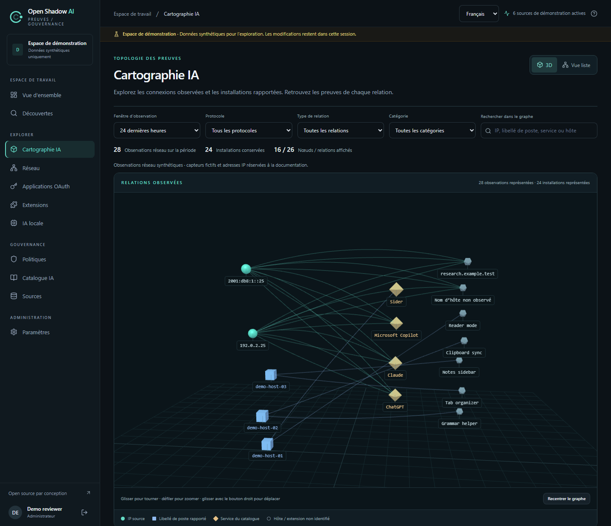
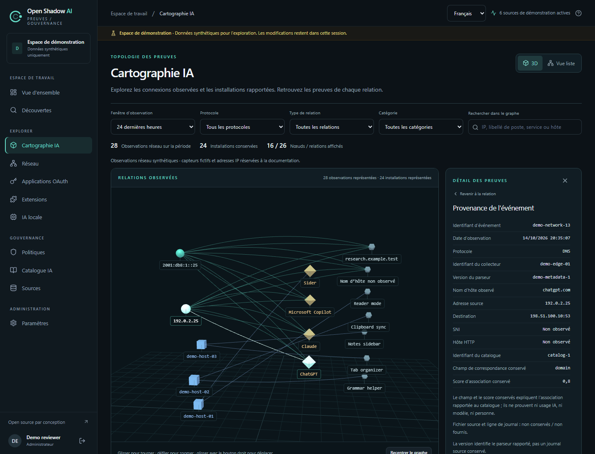
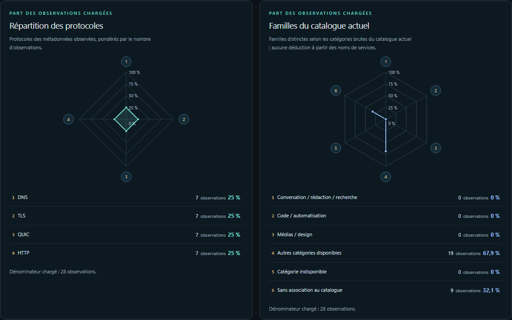

# Cartographie IA

[English](../cartography.md) | [Français](cartography.md) | [简体中文](../zh-CN/cartography.md)

La vue `/cartography` d'Open Shadow AI relie observations réseau et installations déclarées sur les postes aux services du catalogue IA. Elle permet d'examiner les preuves conservées ; elle ne scanne pas les postes et n'établit pas un usage réel de l'IA. Cette fonctionnalité nécessite une révision source contenant la route de cartographie : consignez le commit exact déployé plutôt que de vous fier au numéro de préversion.



Capture de l'application réelle, interface en français, données fictives de démonstration. Les groupes d'IP sources et de postes déclarés sont distincts, sans rapprochement entre eux.

## 1. Lire les relations

| Relation | Preuve sous-jacente | Ce qu'elle ne permet pas d'établir |
|---|---|---|
| IP source → service ou domaine observé | Observations réseau regroupées par `source_ip`, `domain`, `catalog_match_id` et `protocol` dans la fenêtre sélectionnée | Appareil, salarié, requête achevée, prompt, modèle, tokens ou transfert de données |
| Poste déclaré → outil IA installé | Inventaire des extensions conservé, avec `host_label` déclaré et périmètre du collecteur | Connexion depuis l'IP de ce poste ou usage réel de l'extension ou de l'outil |
| Observation → service du catalogue | `catalog_match_id`, `match_field` et `match_confidence` conservés, avec les libellés actuels du catalogue lorsqu'ils sont disponibles | Preuve d'inférence ou score d'usage ou de risque |

Une IP et un poste déclaré sont des nœuds distincts. Aucun rapprochement AD, DHCP, NAT, appareil ou personne n'est déduit. Les libellés de postes sont regroupés au sein de chaque collecteur ; un libellé est une preuve déclarée, pas l'identité vérifiée d'un appareil physique. Adresses, noms et associations au catalogue inconnus restent inconnus. Les domaines et extensions sans correspondance sont distincts des services du catalogue. Un libellé de service désigne une association au catalogue, pas un modèle exact. `match_confidence`, compris entre 0 et 1, décrit uniquement la correspondance au catalogue.

Les observations réseau portent sur la fenêtre sélectionnée. Les installations suivent la fenêtre existante de rétention de l'inventaire et des identités ; la sélection temporelle du graphe ne les transforme pas en activité réseau. Plusieurs observations ne constituent pas un compte de requêtes IA, et un graphe vide ne prouve pas l'absence d'IA.

## 2. Ouvrir et investiguer

1. Connectez-vous en tant qu'**analyste** ou **administrateur**, puis ouvrez `/cartography`.
2. Sélectionnez la fenêtre d'observation réseau de **24 ou 168 heures** et, si nécessaire, un protocole. Examinez les totaux et les avertissements de troncature avant d'interpréter le dessin. Type de relation, catégorie et recherche textuelle filtrent les relations déjà chargées ; ils ne récupèrent pas toutes les preuves omises par le serveur.
3. Sélectionnez une relation ou son entrée dans la liste accessible pour examiner les preuves conservées. Distinguez toujours l'IP source affichée du libellé de poste déclaré.
4. Pour une preuve réseau, examinez l'UUID de l'événement, son horodatage, le protocole, les adresses source et destination, le port de destination, le domaine observé, l'identifiant du collecteur, la version du parseur et les champs de correspondance conservés. Les champs absents restent indisponibles.
5. Pour une installation, examinez l'enregistrement d'inventaire et utilisez le lien de découverte uniquement lorsqu'un véritable identifiant de détection existe. Une installation sans détection reste une preuve de présence ; aucune découverte n'est inventée.

Le nom du fichier journal source et son numéro de ligne **ne sont pas conservés** et sont indisponibles dans les détails. La cartographie ne fournit ni accès à des fichiers arbitraires ni téléchargement des journaux bruts. L'export distinct des métadonnées du collecteur réseau est décrit dans l'[analyse réseau passive (référence en anglais)](../network-analysis.md).



Panneau réel de détail d'événement, interface en français, données fictives de démonstration. L'identifiant affiché est synthétique, pas un UUID de production. Le score conservé explique une association au catalogue et ne prouve pas un usage de l'IA.

## 3. Naviguer dans la vue

La vue 3D utilise une caméra en perspective : faites glisser pour tourner autour du graphe, utilisez la molette pour zoomer et le glisser avec le bouton droit pour déplacer la vue. **Recentrer le graphe** réinitialise la caméra et ajuste le cadrage. Cliquez sur un nœud pour voir ses relations, ou sur un lien pour examiner cette relation. **Vue liste** est un tableau 2D des relations ; elle sert aussi de repli automatique lorsque WebGL2 ou la scène 3D est indisponible.

Au clavier, utilisez les boutons de source, de service et **Examiner la relation** du tableau. La section **Sélectionner un nœud au clavier** propose aussi des boutons de nœuds en mode 3D. Dans le panneau de détail, ouvrez l'UUID d'un événement pour examiner sa provenance conservée. **Échap** revient du détail de l'événement à la relation, ou ferme le panneau de détail. Sélectionner une IP source ou un service du catalogue liste ses événements sur tous les protocoles de la fenêtre ; sélectionner une relation réseau applique sa source, son domaine, son association au catalogue et son protocole exacts.

Le rendu est borné et effectué à la demande, sans animation au repos ni amortissement de caméra, y compris pour les utilisateurs préférant réduire les animations. Distance, taille des nœuds et position visuelle ne mesurent ni topologie réseau réelle, ni volume transféré, ni risque. Le graphe représente les preuves, pas le trajet des paquets.

### Lire les deux radars réseau

Les deux cartes radar indépendantes résument les relations réseau chargées pour la fenêtre temporelle et la requête de protocole actuelles, **avant** les filtres locaux de type de relation, de catégorie et de recherche et les bornes du dessin de 160 nœuds/320 liens. Les installations sont exclues ; elles restent des preuves de présence dans leur fenêtre de rétention indépendante.



Capture de l'application réelle, interface en français, données synthétiques de démonstration. Les parts portent uniquement sur les observations chargées.

Chaque axe est pondéré par les observations, pas par le nombre de relations. Soit `R` l'ensemble des tuples exacts uniques (`source_ip`, `domain`, `catalog_match_id`, `protocol`) après la déduplication existante. Alors `D = Σ(r ∈ R) observations(r)`, `n(axis) = Σ(r ∈ axis) observations(r)` et `share(axis) = 100 × n(axis) / D`. Les deux radars utilisent la même échelle **0–100%**. Avec `D = 0`, le résumé est indisponible et aucun polygone n'est tracé ; avec `D > 0`, un axe absent vaut **0%**. La surface du polygone n'est ni un score agrégé ni une mesure d'activité, de risque ou de confiance de correspondance.

Le radar des protocoles comporte exactement quatre axes : `DNS`, `TLS`, `QUIC` et `HTTP`. Le radar des familles du catalogue comporte six axes, selon les catégories **actuelles** du catalogue chargé :

| Axe de famille du catalogue | Relations incluses |
|---|---|
| Conversation, rédaction et recherche | `llm_chat`, `writing_assistant`, `translation_ai`, `search_ai` |
| Code et automatisation | `code_assistant`, `agent_automation` |
| Médias et design | `image_gen`, `voice_ai`, `video_ai`, `design_ai` |
| Autre catégorie disponible | Toute autre catégorie non vide, notamment plateformes, données, catégories personnalisées et `saas_app` de la démonstration |
| Catégorie indisponible | `catalog_match_id` non nul dont l'entrée n'est pas chargée ou dont la catégorie est vide |
| Aucune association au catalogue | `catalog_match_id` nul ou absent |

Une entrée de catalogue introuvable n'est pas une absence d'association. Les catégories restent libres ; le regroupement ne les renomme pas et ne déduit pas une famille d'une marque ou d'un nom de service. Les catégories actuelles ne reconstituent pas la classification historique. Une association au catalogue ne prouve ni usage, activité, modèle ou identité, ni risque ou confiance. Si le chargement du catalogue échoue, le radar des familles est indisponible au lieu d'être rempli de zéros synthétiques ; celui des protocoles reste utilisable lorsque les relations réseau sont valides. Une erreur réseau ne substitue pas un autre jeu de données.

Comparez le dénominateur chargé calculé et affiché `D` avec `total_observations` pour la fenêtre demandée et l'avertissement `truncated` ; vérifiez aussi la couverture du catalogue, limitée à **500 entrées**. Les **500 premiers groupes de relations** du serveur sont un échantillon chargé, pas un échantillon représentatif de toute la fenêtre. N'extrapolez pas leurs parts aux observations omises. Les filtres locaux du graphe et les bornes du dessin ne changent pas ce dénominateur.

Sélectionnez le bouton natif de légende d'un axe, à la souris ou au clavier, pour lister les relations chargées correspondantes avec leurs comptes et détails. Sélectionner un axe ne modifie pas les filtres du graphe et ne recalcule pas le dénominateur. Toute relation listée, même hors des bornes du dessin, peut être examinée avec les filtres exacts d'événements et leurs gardes existants. Son panneau de détail indique explicitement un **contexte isolé à une seule relation** : les voisins des nœuds sont limités à ce graphe isolé. Les requêtes d'événements par source ou service peuvent toujours inclure volontairement tous les protocoles, comme décrit ci-dessus. Un changement de fenêtre ou de protocole, une nouvelle réponse, une erreur ou un refus d'autorisation efface les détails de relation et d'événement ciblés. Les détails d'événement n'acquièrent ni nom de fichier source ni numéro de ligne.

## 4. Vérifier couverture et limites

Le navigateur dessine au plus **160 nœuds et 320 liens**. Il lit au plus **500 relations réseau**, **300 lignes d'inventaire** sur trois pages et **500 entrées du catalogue** sur cinq pages. Les identifiants de catalogue non chargés restent littéraux, sans noms ni catégories inventés. Le serveur retourne les totaux exacts `total_relations` et `total_observations` dans le périmètre réseau demandé, compte le sous-ensemble renvoyé dans `represented_relations` et `represented_observations`, et signale explicitement la troncature avec `truncated`. Ces comptes de sous-ensemble API portent sur les lignes renvoyées avant filtres et bornes du dessin dans le navigateur. Les totaux peuvent dépasser le graphe affiché ; le dessin et la liste constituent un sous-ensemble borné. Examinez les avertissements de couverture de l'inventaire et du catalogue plutôt que de considérer une page ou un graphe tronqué comme un inventaire complet.

**Limite de relations du serveur atteinte.** indique que le serveur a renvoyé moins de groupes que le total de la période entière. **Limite de pages de l’inventaire atteinte.** indique que moins de lignes d'inventaire ont été chargées que le total conservé. Un avertissement distinct du graphe compte les relations chargées omises par les bornes d'affichage 160/320. La vue distingue relations réseau renvoyées/totales, installations conservées chargées/totales et groupes visibles de libellés IP/postes ; ces groupes ne sont pas des comptes d'appareils ou de salariés. La recherche ne dépasse pas les 500 relations ou 300 lignes d'inventaire chargées. Modifiez la période ou le protocole pour demander une autre sélection réseau, ou utilisez **Ouvrir les observations réseau** (`/network?hours=24&protocol=TLS`) et **Ouvrir l’inventaire complet** (`/extensions?view=inventory`) pour examiner les vues paginées existantes.

DNS chiffré, ECH, NAT/VPN, domaines partagés, trafic non recopié, profils inaccessibles et postes non collectés laissent des lacunes. Les comptes portent seulement sur les observations importées ; trafic non observé et pannes des capteurs restent inconnus. Le DNS peut refléter recherches, préchargement ou cache sans connexion ; une observation DNS est une preuve plus faible qu'une connexion observée. Le SNI TLS/QUIC et l'hôte HTTP exposent des noms, tandis que le contenu chiffré reste inconnu. Les réglages de confidentialité et la rétention existants continuent de s'appliquer aux libellés d'inventaire et aux événements ; la cartographie ne réécrit pas les libellés historiques. Voir la [couverture des sources (référence en anglais)](../collectors.md) et l'[exploitation des collecteurs (référence en anglais)](../collector-operations.md).

## 5. Lire les preuves par API

Ces lectures sous `/api/v1/network` utilisent l'authentification de la console et sont réservées aux analystes et administrateurs :

| Requête | Bornes et signification |
|---|---|
| `GET /api/v1/network/relations?hours=24&limit=300` | `hours` : 1–168, défaut 24 ; `limit` : 1–500, défaut 300. Filtre `protocol` facultatif ; preuves réseau regroupées, totaux exacts et troncature explicite |
| `GET /api/v1/network/events?hours=24&source_ip=192.0.2.10&catalog_match_id=example-service&domain=example.invalid` | Filtres exacts `source_ip`, `catalog_match_id` et `domain` ; une valeur vide sélectionne les valeurs inconnues. Les filtres de protocole et de pagination existants restent disponibles |
| `GET /api/v1/network/events/00000000-0000-0000-0000-000000000001?hours=24` | Un UUID d'événement conservé dans le même tenant et la même fenêtre ; `hours` conserve la borne 1–168 et le défaut de 24 heures |

Par exemple, lisez les relations TLS sur 24 heures avec la session existante et authentifiée de la console :

```http
GET /api/v1/network/relations?hours=24&protocol=TLS&limit=300
```

L'IP, l'identifiant de catalogue, le domaine et l'UUID ci-dessus sont illustratifs, pas des observations réelles. Ne les utilisez pas comme preuves de déploiement. Le périmètre du tenant est un garde d'accès ; l'installation sert toujours une seule organisation.

## 6. Gérer une preuve indisponible

Un compte lecteur reçoit `403` ; la déconnexion ou un refus d'autorisation masque immédiatement les données sensibles de la cartographie. Un événement absent, expiré, hors fenêtre ou d'un autre tenant reçoit un `404` générique, sans révéler où il existe. Un magasin d'événements indisponible renvoie un `503` expurgé, sans détails d'exception du backend. Reconnectez-vous ou rétablissez la source ou le magasin selon les procédures existantes, puis réessayez dans la fenêtre de rétention applicable.

## 7. Évaluer avec la démonstration

La session `/demo` existante fournit une cartographie fictive dérivée de ses observations et de son inventaire synthétiques. Elle ne demande aucun identifiant backend et ne prouve ni couverture d'un parc réel, ni déploiement en production, ni performances du navigateur à grande échelle, ni qualification du déploiement. Suivez les [instructions de démonstration](../../README.fr.md#essayer-linterface), puis utilisez une source maîtrisée et des preuves connues pour évaluer la révision déployée.
