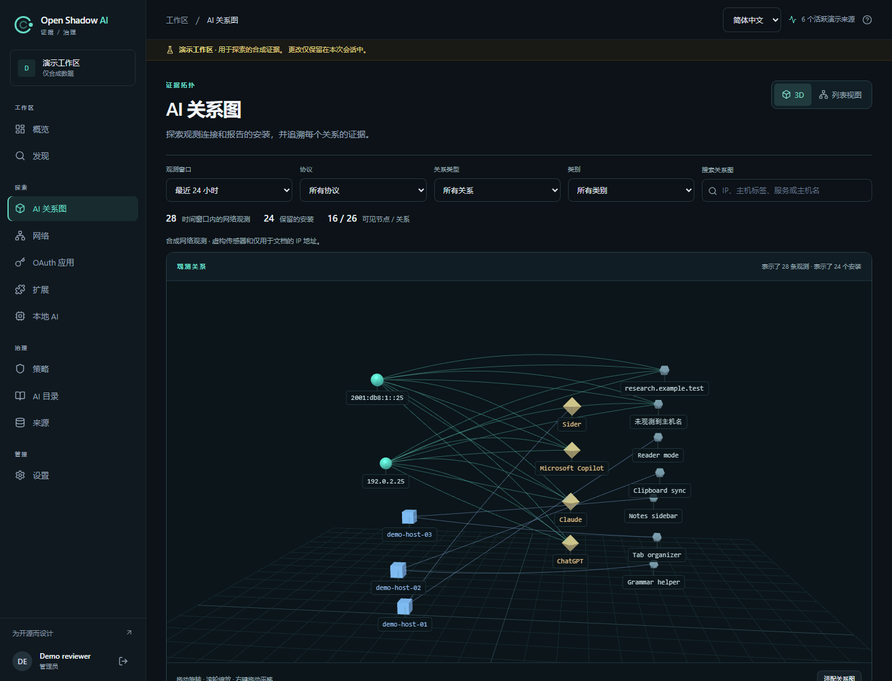
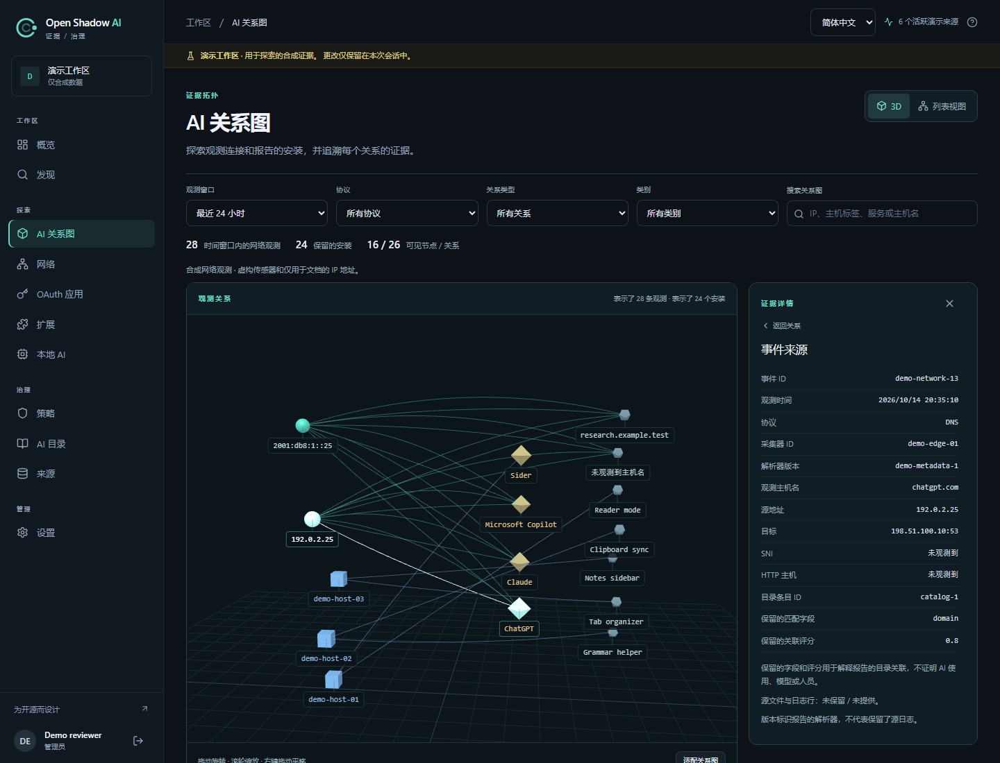

# AI 关系图

[English](../cartography.md) | [Français](../fr/cartography.md) | [简体中文](cartography.md)

Open Shadow AI 的 `/cartography` 页面将网络观测和主机报告的安装清单与 AI 目录服务相连，便于检查保留的证据。它不会扫描主机，也不能证明实际使用了 AI。此功能需要包含该路由的源代码修订；核对可用性时应记录实际部署的准确提交，不能只看预览版本号。



实际应用截图，界面为简体中文，数据为虚构演示数据。来源 IP 组和报告的主机组彼此独立，没有推断关联。

## 1. 理解关系

| 关系 | 对应证据 | 无法证明的内容 |
|---|---|---|
| 来源 IP → 观测到的服务或域名 | 在所选时间窗口内按 `source_ip`、`domain`、`catalog_match_id` 和 `protocol` 分组的网络观测 | 设备、员工、已完成的请求、提示词、模型、词元数或数据传输 |
| 报告的主机 → 已安装的 AI 工具 | 保留的浏览器扩展清单，包含报告的 `host_label` 和采集器范围 | 连接来自该主机的 IP，或扩展、工具被实际使用 |
| 观测 → 目录服务 | 保存的 `catalog_match_id`、`match_field` 和 `match_confidence`；目录标签可用时采用当前标签 | 推理发生的证据，或使用、风险评分 |

IP 与报告的主机是独立节点。系统不推断 AD、DHCP、NAT、设备或人员之间的关联。主机标签在各自采集器范围内分组；标签属于报告的证据，并非经验证的物理设备身份。未知的地址、名称和目录关联保持未知。未匹配的域名和扩展与目录服务分别显示。服务标签表示与目录的关联，不表示确切模型。`match_confidence` 取值为 0 到 1，仅描述目录匹配的置信度。

网络观测采用所选时间窗口。安装证据采用现有清单与身份保留窗口；图中的时间选择不会将安装记录转变成网络活动。多条观测不能作为 AI 请求数，空图也不能证明环境中没有 AI。

## 2. 打开页面并调查

1. 以**分析员**或**管理员**身份登录，然后打开 `/cartography`。
2. 选择 **24 或 168 小时**的网络观测窗口，按需选择协议。先查看总数和截断提示，再解读图形。关系类型、类别和文本搜索仅筛选已加载的关系，不会获取服务器省略的全部证据。
3. 选择一条关系或无障碍列表中的对应条目，检查保留的证据。始终区分显示的来源 IP 与报告的主机标签。
4. 对网络证据，检查事件 UUID、时间戳、协议、来源及目标地址、目标端口、观测域名、采集器 ID、解析器版本和保存的目录匹配字段。缺失字段保持不可用。
5. 对安装证据，检查清单记录；只有存在真实检测 ID 时，才提供可用的发现详情链接。没有检测记录的安装仍是存在证据，不会虚构发现记录。

来源日志的文件名和行号**未被保留**，事件详情无法提供这些信息。关系图不提供任意文件访问或原始日志下载。网络采集器的独立元数据导出见[被动网络分析（英文参考）](../network-analysis.md)。



实际事件详情面板，界面为简体中文，数据为虚构演示数据。图中的演示标识是合成值，并非生产 UUID。保存的分数解释目录关联，不能证明使用了 AI。

## 3. 操作视图

3D 视图采用透视相机：拖动可绕图旋转，滚轮可缩放，按住右键拖动可平移。**适配关系图**会重置相机并调整取景。点击节点可查看相连关系，点击边可检查对应关系。**列表视图**提供 2D 关系表格；WebGL2 或 3D 场景不可用时自动切换到该视图。

可用键盘操作表格中的来源、服务和**查看关系**按钮。3D 模式下，**使用键盘选择节点**折叠区也提供节点按钮。在详情面板中，打开事件 UUID 可检查保留的来源信息。**Escape** 从事件详情返回关系详情，或关闭详情面板。选择来源 IP 或目录服务时，会列出所选窗口内所有协议的对应事件；选择网络关系时，则精确限定来源、域名、目录关联和协议。

渲染规模设有上限，并按需执行，没有空闲动画或相机阻尼，也适用于偏好减少动态效果的用户。布局距离、节点大小和视觉位置不衡量实际网络拓扑、传输量或风险。图形展示证据关系，不重建数据包路径。

## 4. 检查覆盖范围与限制

浏览器最多绘制 **160 个节点和 320 条边**，最多读取 **500 条网络关系**、三页共 **300 条清单记录**以及五页共 **500 个目录条目**。未加载的目录 ID 保留原值，不会虚构名称或类别。服务器返回请求网络范围内准确的 `total_relations` 和 `total_observations`，在 `represented_relations` 和 `represented_observations` 中统计返回的子集，并用 `truncated` 明确标记截断。这些 API 子集计数针对返回的记录，尚未应用浏览器筛选和绘图上限。总数可能超过图中显示的范围；画布和列表均为有上限的子集。应检查清单和目录覆盖提示，不能将单页或截断的图形视为完整清单。

**已达到服务器关系数量上限。**表示服务器返回的分组少于完整窗口的总数。**已达到清单页数上限。**表示加载的清单记录少于保留总数。独立的图形提示统计因 160/320 显示上限而省略的已加载关系。界面分别显示服务器返回/总计网络关系、已加载/总计保留安装，以及可见的 IP/主机标签组；这些分组数量不是设备或员工数量。搜索无法超出已加载的 500 条关系或 300 条清单记录。更改窗口或协议可请求其他网络选择，也可使用**打开网络观测**（`/network?hours=24&protocol=TLS`）和**打开完整清单**（`/extensions?view=inventory`）查看现有分页视图。

加密 DNS、ECH、NAT/VPN、共享域名、未镜像的流量、无法访问的配置文件和未采集的主机都会留下缺口。计数仅涵盖导入的观测；未观测流量和传感器中断保持未知。DNS 可能反映没有连接的查询、预取或缓存，因此 DNS 观测的证据强度低于已观测连接。TLS/QUIC SNI 和 HTTP Host 暴露名称，而加密内容保持未知。现有隐私设置和保留规则继续适用于清单标签与事件；关系图不会改写历史标签。参见[来源覆盖范围（英文参考）](../collectors.md)和[采集器运维（英文参考）](../collector-operations.md)。

## 5. 通过 API 读取证据

以下 `/api/v1/network` 读取接口使用控制台身份验证，仅限分析员和管理员：

| 请求 | 范围与含义 |
|---|---|
| `GET /api/v1/network/relations?hours=24&limit=300` | `hours`：1–168，默认 24；`limit`：1–500，默认 300。可选 `protocol` 筛选；提供分组网络证据、准确总数及明确的截断标记 |
| `GET /api/v1/network/events?hours=24&source_ip=192.0.2.10&catalog_match_id=example-service&domain=example.invalid` | 精确匹配 `source_ip`、`catalog_match_id` 和 `domain`；空筛选值选择未知值。现有协议和分页筛选仍可使用 |
| `GET /api/v1/network/events/00000000-0000-0000-0000-000000000001?hours=24` | 读取同一租户和时间窗口内一个保留事件的 UUID；`hours` 同样限定为 1–168，默认 24 小时 |

例如，通过现有的已认证控制台会话读取 24 小时内的 TLS 关系：

```http
GET /api/v1/network/relations?hours=24&protocol=TLS&limit=300
```

以上 IP、目录 ID、域名和 UUID 均为示例标识，不是真实观测。不能将它们当作部署证据。租户范围属于访问保护措施；每个部署仍只服务一个组织。

## 6. 处理不可用的证据

只读用户收到 `403`；注销或授权被拒绝后，敏感关系图数据立即隐藏。事件不存在、已过期、超出窗口或属于其他租户时，接口返回通用 `404`，不会透露事件所在位置。事件存储不可用时返回经过清理的 `503`，不暴露后端异常详情。按现有流程重新登录或恢复来源、存储，再在适用保留窗口内重试。

## 7. 使用演示评估

现有 `/demo` 会话提供由其合成观测与清单生成的虚构关系图，无需后端凭据。它不能证明真实设备群的覆盖范围、生产部署完成、大规模浏览器性能或部署验收通过。按照[界面演示步骤](../../README.zh-CN.md#体验界面)操作，然后用受控来源和已知证据评估实际部署的修订。
